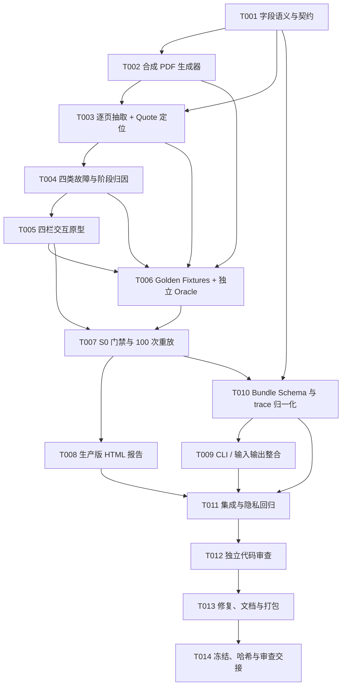

# P026 引文落页镜（PageTrace）实施计划书

**PROJECT_ID：** P026  
**SLUG：** `pagetrace`  
**规格版本：** v1.0.0  
**状态：** `SPECIFICATION_DRAFT / WAITING_OWNER_REVIEW / NO_GO / NO_CODE_BUILT`  
**总工时：** 88 小时（单人等效工作量；计划约两周）  
**真人参与者：** 0；合成数据 + 独立 Oracle + 自动化测试  
**许可证：** MIT  
**权威需求：** `PROJECT_BOOK.md` v1.0.0

> 本计划是施工合同，不是施工记录。任务状态初始均为 `TODO / NOT_VERIFIED`。Muse 负责调度、版本与证据门禁，不编写业务代码、不替施工 Agent 写测试。所有源码、测试、修复、集成与技术文档由 Muse 已实测可用的免费 Coding Agent 在虚拟机独立新会话中完成。项目方核对规格前不得启动 T001。

## 0. 执行摘要与不可变决定

### 0.1 产品范围

PageTrace 对 PDF 的真实物理页身份与 RAG 引用链路逐阶段对账：Extraction → Chunking → Indexing → Display。它检测页码错位、页元数据缺失、重复文本歧义和文本层无法定位，并给出首个可证明的偏差阶段。它不判断引用内容真假，不做 OCR，不实现 RAG，不连接真实 Open WebUI / RAGFlow 私有接口。

### 0.2 不可变决定

1. 唯一项目：P026 PageTrace；不得在施工中换成 StreamSeam、BrowserContract 或 ReviewReceipt。
2. 页码语义以 `PROJECT_BOOK.md` 第 4 节为准：`pdf_page_index0` 为 0-based 物理页索引；`pdf_page_number1` 与 `viewer_page1` 为 1-based；`pdf_page_label` 是可选标签，绝不与物理页号混用。
3. 四阶段对账顺序固定为 Extraction → Chunking → Indexing → Display；首个可证明差异为 `first_fault_stage`。缺少阶段 trace 必须输出 `UNKNOWN_TRACE_MISSING`，不能猜测。
4. S0 固定 48 个故障型合成 PDF 案例，每类 12 组；每个 PDF 至少有 1 条正常控制引用；故障 48/48 检出、阶段定位 48/48、控制误报 0、生产实现与独立 Oracle 完全一致、100 次规范化重放 1 个哈希。
5. 生产 PDF 抽取使用 pypdf；独立 Oracle 使用 pdfminer.six；二者不共享生产算法代码。Golden expected 不能由生产代码自动生成后直接充当真值。
6. 产品本身不依赖 LLM、GPU、数据库、收费 API 或运行时联网；所有文档与用户 PDF 本地处理。
7. UI 使用原生 HTML/CSS/JavaScript；不引入远程 CDN、字体、分析服务或第三方在线组件。
8. MIT 为项目自有代码许可证；所有第三方依赖许可证必须在 T013 核查并归档，避免 AGPL / 商业授权依赖。
9. 总工时严格为 88h。超出范围的 OCR、真实 RAG adapter、坐标级定位、语义核验全部延期，不通过扩任务暗中加入。
10. 用户只要求两份 Markdown 规格；本轮不生成 DOCX，不将 DOCX 标为缺失交付。

### 0.3 环境事实探测

T001 开始前记录真实环境，不用历史记录替代：

```bash
python --version
python -c "import sys,platform; print(sys.version); print(platform.platform()); print(platform.machine())"
python -m pip --version
```

同时记录 CPU 核数、RAM、可用磁盘、浏览器名称/版本、实际工作区绝对路径与网络限制。若当前 VM 为 Windows，以 Windows 为主测试平台；若 Muse 实测 VM 为 Linux，则以当前系统为主测试平台，并对 Windows 路径、文件名与命令兼容性做静态审查。未实际运行的平台一律写 `NOT_TESTED`。

## 1. 阶段、门槛与总工时

| 阶段 | 任务 | 工时 | 交付 | 退出门槛 |
|---|---|---:|---|---|
| S0 核心算法与硬门 | T001–T007 | 41h | 字段契约、合成 PDF、抽取/定位/归因、Golden、独立 Oracle、S0 runner | 48/48 检出与定位；正常控制 0 误报；Oracle parity；100 次 1 hash；否则 STOP |
| S1 产品入口与报告 | T008–T010 | 18h | 四栏 HTML、CLI、bundle schema / trace import | 用户本地 PDF 与 bundle 能被验证；缺 trace 时明确 UNKNOWN；报告离线可打开 |
| S2 集成回归 | T011 | 7h | 端到端测试与隐私测试 | 全量测试通过；没有网络调用或路径泄露；核心结果与 S0 一致 |
| S3 独立代码审查 | T012 | 6h | 独立审查包与问题清单 | 0 未关闭 P0/P1；P2 登记，不无限扩展防御工程 |
| S4 修复、打包与冻结 | T013–T014 | 16h | 修复、文档、MIT/依赖清单、source ZIP、哈希与发布证据 | 干净环境重跑通过；文件/哈希/日志覆盖齐全；可供 GPT 独立终审 |
| **合计** | **T001–T014** | **88h** |  |  |

### 1.1 工时分配（锁定）

| TASK_ID | 工时 |
|---|---:|
| T001 | 4h |
| T002 | 6h |
| T003 | 8h |
| T004 | 6h |
| T005 | 6h |
| T006 | 6h |
| T007 | 5h |
| T008 | 7h |
| T009 | 5h |
| T010 | 6h |
| T011 | 7h |
| T012 | 6h |
| T013 | 8h |
| T014 | 8h |
| **总计** | **88h** |
## 2. 依赖图与并行边界



- S0 的 T001–T007 顺序施工，避免字段语义与生产算法并行漂移。
- S0 PASS 后，T008 与 T010 可在独立 worktree 并行；二者文件归属不得重叠。
- T009 依赖 T010 的冻结 schema；T011 必须等 T008/T009/T010 全部 PASS。
- T012 是只读审查，不与施工共享写权限；T013 才按审查清单修复。
- 禁止两个 Agent 同时修改同一文件；集成与合并由施工/集成 Agent 执行，Muse 只调度、运行门禁、核验和归档。

## 3. 第一周日程（T001–T007，41h）

| 日程 | 任务 | 主要工作 | 当日交接 |
|---|---|---|---|
| Day 1 | T001（4h） | 冻结页码字段语义、0/1-based 转换、bundle / report 基本类型、状态枚举 | `PAGE_SEMANTICS.md`、schema 草案、字段样例 |
| Day 2 | T002（6h） | 生成含中文、空白页、重复句子、跨页断句、扫描件式无文本页的 PDF fixture | 48 个 fixture spec 与 PDF 生成器；固定元数据 |
| Day 3 | T003（8h） | pypdf 逐页抽取；完成 NFC/空白规范化、精确 quote 定位、重复候选页与跨页引用 | extraction records、locator 模块与单元测试 |
| Day 4 | T004（6h） | 实现四类故障检测与四阶段 first divergence 定位 | verdict 模块与每阶段首错样例 |
| Day 5 | T005（6h） | 完成四栏交互原型：PDF 真值、抽取、分片/索引、最终引用联动 | 本地 prototype HTML/CSS/JS 与交互截图 |
| Day 6 | T006（6h） | 建 Golden Fixtures 与独立 pdfminer.six Oracle；手工复核预期输出 | `expected.json`、Oracle 报告、独立性检查 |
| Day 7 | T007（5h） | 汇总 48 组 S0 自动门禁、Oracle parity、控制误报与 100 次规范化重放 | `S0_REPORT.json`、日志、重放 hash 清单 |

**Day 7 结束必须做 S0 GO/STOP 判定。** 任意硬门未通过则停止 S1，不得先做漂亮 UI 再回头掩盖算法缺陷。修复只针对可复现的 P0/P1；失败任务重新开独立会话，不能依赖原施工聊天。
## 4. 仓库与工作区布局

建议工作树：

```text
P026-pagetrace/
├── prototypes/                # T005 第一周四栏交互原型
├── 00_control/
│   ├── PROJECT_STATE.json
│   ├── TASKBOARD.csv
│   ├── DECISIONS.md
│   ├── HANDOFF.md
│   └── CHANGELOG.md
├── 01_project_book/
│   └── PROJECT_BOOK.md
├── 02_implementation_plan/
│   └── IMPLEMENTATION_PLAN.md
├── 03_tasks/
│   ├── TASK-001.md ... TASK-014.md
│   └── HANDOFFS/
├── 04_source/
│   ├── source/                  # git 工作树或源码根
│   ├── source-release.zip
│   ├── SOURCE_MANIFEST.csv
│   └── SHA256SUMS.txt
├── 05_tests/
│   ├── TEST_PLAN.md
│   ├── test-results/
│   └── s0/
├── 06_reviews/
│   ├── TASK_REVIEWS/
│   ├── MUSE_AUDIT.md
│   ├── REVIEW_COVERAGE.csv
│   └── GPT_FINAL_REVIEW.md
├── 07_evidence/
│   ├── screenshots/
│   ├── demo/
│   ├── runtime_logs/
│   └── REVIEW_PACKS/
│       ├── REVIEW_INDEX.md
│       ├── REVIEW_PACK_01.md
│       └── REVIEW_PACK_02.md
└── 08_release/
    ├── README.md
    ├── USER_GUIDE.md
    ├── HOW_TO_REPRODUCE.md
    ├── RELEASE_NOTES.md
    └── final-deliverables/
```

规格源文件应复制到上述 `01_project_book/` 与 `02_implementation_plan/`；Drive 当前文件夹 ID 由项目方提供，Muse 不另建重复文件夹，不擅自更名。

## 5. 模块归属与接口冻结

| 模块 | 文件归属 | 责任 | 输入 | 输出 |
|---|---|---|---|---|
| 契约 | `contracts/`、`docs/PAGE_SEMANTICS.md` | schema、字段语义、枚举 | PDF 元数据、trace JSON | validated bundle / report types |
| PDF 输入 | `src/pagetrace/pdf_input.py` | 大小、hash、页数、加密校验 | 本地 PDF path | `PdfDocumentInfo` |
| 抽取/定位 | `src/pagetrace/extract.py`、`normalize.py`、`locate.py` | pypdf 逐页抽取、NFC、空白折叠、quote 候选 | `PdfDocumentInfo` + quote | `PageTextRecord[]`、`QuoteMatch` |
| 第一周 UI 原型 | `prototypes/report-prototype.*` | 先验证四栏信息结构 | fixture verdicts | 本地交互原型 |
| 阶段比较 | `trace_bundle.py`、`compare_stages.py` | 四阶段数据校验与首错定位 | `TraceBundle` + `QuoteMatch` | `StageDiff[]` |
| 判定 | `verdicts.py` | 四类故障及 UNKNOWN | `StageDiff[]` | `CitationVerdict` |
| CLI/报告 | `cli.py`、`report_json.py`、`report_html.py` | 命令行、JSON、HTML | bundle + verdicts | 输出目录 |
| UI 资源 | `assets/report.css`、`assets/report.js` | 四栏联动、过滤、展开 | report JSON 内嵌数据 | 离线 HTML |
| 独立 Oracle | `tests/oracle/` | 独立解析和预期结果计算 | fixture PDF + golden specs | parity rows |

### 5.1 核心类型（语义性伪代码）

```python
PageTextRecord(
    pdf_page_index0: int,
    pdf_page_label: str | None,
    text_state: Literal["TEXT", "EMPTY", "IMAGE_ONLY", "ERROR"],
    text_sha256: str | None,
    extracted_text: str | None,
)

CitationInput(
    citation_id: str,
    quote_text: str,
    chunk_id: str | None,
    index_record_id: str | None,
    citation_page_value: int | str | None,
    citation_page_basis: Literal["PDF_INDEX_0", "PDF_NUMBER_1", "PDF_LABEL", "UNKNOWN"],
)

CitationVerdict(
    verdict: str,
    fault_type: str | None,
    first_fault_stage: str | None,
    candidate_source_pages0: list[int],
    expected_source_pages0: list[int] | None,
    observed_page_value: int | str | None,
    correct_pdf_page_number1: list[int] | None,
    correct_viewer_page1: list[int] | None,
    evidence: list[dict],
)
```

实际类型以 T001 的 schema 冻结结果为准；不得把缺失值默认为 0，不得把空列表解释成“已验证没有来源页”。

## 6. T001–T014 原子任务卡

每张任务卡由 Muse 单独派发到一个全新免费模型会话。施工 Agent 只修改任务卡允许路径；任务验收 PASS 后才合并。模型平台/模型名称由 Muse 从已实测免费清单选择，不在规格中杜撰。

### T001 — 页码字段语义与契约冻结

- **ROLE / 优先级：** IMPLEMENTER / P0；**工时：** 4h；**依赖：** 无。
- **目标：** 把 `PROJECT_BOOK.md` 第 4、6 节转为机器可校验的字段契约，消除 `page` 语义歧义。
- **输入：** `PROJECT_BOOK.md`；Open WebUI #33603 页码基准案例。
- **输出路径：** `contracts/pagetrace.bundle.v1.schema.json`、`contracts/pagetrace.report.v1.schema.json`、`docs/PAGE_SEMANTICS.md`、`tests/unit/test_page_semantics.py`。
- **允许修改：** 以上四个路径；新建必要的 `contracts/`、`docs/`、`tests/unit/`。
- **禁止修改：** PDF 解析器、CLI、UI、Golden fixtures、许可证文件。
- **验收命令：** `python -m pytest tests/unit/test_page_semantics.py -q`；`python -m json.tool contracts/pagetrace.bundle.v1.schema.json`；`python -m json.tool contracts/pagetrace.report.v1.schema.json`。
- **硬断言：** 0-based -> 1-based 只允许 `+1`；viewer 目标只能是 1-based；page label 不得做算术转换；UNKNOWN basis 不得转换；越界页拒绝。
- **证据：** schema 校验日志、字段表、至少 12 个边界 fixture 的测试输出、commit SHA。
- **完成定义：** 所有字段都有名称/类型/基准/缺省语义；无含糊裸 `page`；独立审查者可按文档复算示例。
- **失败回退：** 不合并；回退该任务分支；保持工作树基线；重新派发新会话修订。

### T002 — 合成 PDF 生成器与 48 份 Fixture Spec

- **ROLE / 优先级：** IMPLEMENTER / P0；**工时：** 6h；**依赖：** T001。
- **目标：** 生成 48 份确定性 PDF，覆盖四类故障各 12 组；每份 PDF 含至少一条正常引用控制项。
- **输入：** T001 schema；PROJECT_BOOK §8 的样本矩阵。
- **输出路径：** `tools/generate_fixtures.py`、`fixtures/specs/`、`fixtures/pdfs/`、`fixtures/README.md`。
- **允许修改：** 上述 fixture 与生成器路径。
- **禁止修改：** `src/pagetrace/` 生产逻辑、`fixtures/golden/expected.json`、Oracle 代码。
- **验收命令：** `python tools/generate_fixtures.py --out fixtures`；`python -m pytest tests/unit/test_fixture_manifest.py -q`。
- **硬断言：** 每类 12 个；中文、空白页、重复文本、跨页断句、图像式无文本页均有覆盖；生成后 PDF 页数、文件 hash 与 manifest 一致；每 PDF 至少一个正常 control citation；固定生成两次结果字节哈希一致。
- **证据：** fixture manifest、PDF SHA 清单、每类至少 2 张预览截图、生成日志。
- **完成定义：** 48 份 PDF 可重复生成；spec 与 PDF 内容一一对应；生成器不依赖外部数据或网络字体下载。
- **失败回退：** 丢弃未通过的 fixtures 输出；保留 fixture spec 修改前版本；不得手工修 PDF 二进制绕过生成器。

### T003 — pypdf 逐页抽取、Quote 定位与候选页

- **ROLE / 优先级：** IMPLEMENTER / P0；**工时：** 8h；**依赖：** T001、T002。
- **目标：** 完成 PDF 输入校验、逐页文本抽取、页标签读取、规范化 quote 定位、重复文本候选集合与相邻页跨页定位。
- **输入：** PDF 样本、T001 schema、T002 fixture PDFs。
- **输出路径：** `src/pagetrace/pdf_input.py`、`src/pagetrace/extract.py`、`src/pagetrace/normalize.py`、`src/pagetrace/locate.py`、`tests/unit/test_extract.py`、`tests/unit/test_locate.py`。
- **允许修改：** 上述模块与测试。
- **禁止修改：** 四类故障 verdict、stage comparator、Oracle、HTML UI。
- **验收命令：** `python -m pytest tests/unit/test_extract.py tests/unit/test_locate.py -q`。
- **硬断言：** 页数与 PDF reader 一致；物理页索引连续从 0 开始；空白/图像页返回 EMPTY/IMAGE_ONLY 或诚实的 EMPTY；加密/损坏/超限输入返回受控错误；默认拒绝超过 50 MiB 或 500 页的输入；NFC 与空白折叠固定；标点/大小写/全半角不做模糊替换；同句多页返回所有候选；跨相邻页引用返回完整页集合；0 候选不猜测；不启动 OCR。
- **证据：** 每页 extraction JSON、页数/hash 对照、中文/重复句/跨页/扫描页定位输出、异常输入日志。
- **完成定义：** 48 份 PDF 均可读入；所有页都有记录或明确错误；locator 不依赖语义模型；无 silent skip。
- **失败回退：** 不合并；保留 pypdf 生产路径；不通过换用未审查的 AGPL 工具规避问题。
### T004 — 四类故障判定与首错阶段归因

- **ROLE / 优先级：** IMPLEMENTER / P0；**工时：** 6h；**依赖：** T003。
- **目标：** 按 Extraction → Chunking → Indexing → Display 顺序比较来源页身份，识别四类故障并定位 first divergence。
- **输入：** PageTextRecord、QuoteMatch、TraceBundle、PROJECT_BOOK §5 与 §7。
- **输出路径：** `src/pagetrace/compare_stages.py`、`src/pagetrace/verdicts.py`、`tests/unit/test_verdicts.py`。
- **允许修改：** 上述模块与测试。
- **禁止修改：** fixture 生成器、Golden expected、Oracle、UI。
- **验收命令：** `python -m pytest tests/unit/test_verdicts.py -q`。
- **硬断言：** PAGE_OFFSET、PAGE_METADATA_MISSING、DUPLICATE_TEXT_AMBIGUITY、UNLOCATABLE 各有正反例；首个差异阶段必须准确；trace 缺失输出 UNKNOWN；扫描页不把无文本误判为引用不存在；重复文本不得强行选择单页。
- **证据：** 每类至少 3 个阶段定位样例；stage diff JSON；测试日志。
- **完成定义：** 所有状态和阶段均由明确输入决定；不确定状态不被转为 PASS。
- **失败回退：** 回退归因分支；任何归因不确定的场景改为 UNKNOWN，不做猜测。
### T005 — 四栏联动交互原型

- **ROLE / 优先级：** IMPLEMENTER / P1；**工时：** 6h；**依赖：** T004。
- **目标：** 在 S0 前做出四栏本地交互原型，验证错误页码、阶段差异和正确来源位置能被清晰呈现。
- **输入：** T002 合成样本、T003 定位输出、T004 verdict / stage diff。
- **输出路径：** `prototypes/report-prototype.html`、`prototypes/report-prototype.css`、`prototypes/report-prototype.js`、`tests/prototypes/`。
- **允许修改：** prototypes 与原型测试；不进入正式 src UI。
- **禁止修改：** `src/pagetrace/` 生产模块、Golden、Oracle、CLI。
- **验收命令：** `python -m pytest tests/prototypes -q`；用实际浏览器打开 `prototypes/report-prototype.html`。
- **硬断言：** 四栏分别显示 PDF 真值、抽取、chunk/index、最终引用；选中 citation 时四栏联动；错误页码、首错阶段、正确来源位置三项同时可见；UNKNOWN/AMBIGUOUS/UNLOCATABLE 不显示为 PASS；无 CDN 或网络请求。
- **证据：** 原型截图、浏览器版本、交互录屏或逐步截图、测试日志。
- **完成定义：** 原型能用至少 4 个不同故障案例演示定位结果；不要求此时具备正式报告导出。
- **失败回退：** 原型不阻断 S0 核心；若原型表现不清晰，保留 JSON 输出并在 T008 生产 UI 中重做，不改动算法门槛。
### T006 — Golden Fixtures 与独立 Oracle

- **ROLE / 优先级：** IMPLEMENTER + 独立 QA / P0；**工时：** 6h；**依赖：** T002、T003、T004、T005。
- **目标：** 为 48 组故障和控制引用建立人工 Golden 真值；以独立 pdfminer.six 路径与独立代码核验。
- **输入：** 48 PDF、fixture specs、项目书 S0 门槛。
- **输出路径：** `fixtures/golden/expected.json`、`tests/oracle/`、`tests/integration/test_oracle_parity.py`。
- **允许修改：** Golden、Oracle、parity tests。
- **禁止修改：** `src/pagetrace/` 生产算法、fixture PDF 字节、S0 gate runner。
- **验收命令：** `python -m pytest tests/oracle tests/integration/test_oracle_parity.py -q`。
- **硬断言：** Oracle 不 import `pagetrace`；不共享 normalize/locate/compare/verdict 代码；Golden 不由生产实现输出反向生成；48 个预期故障类别、阶段、页集合逐一有独立说明；控制引用全部 PASS。
- **证据：** Oracle 独立性 grep / import graph、Golden 审核表、pdfminer 与 pypdf 页文本对照日志。
- **完成定义：** 独立 Oracle 可从 fixture spec + PDF 产生期望结论；所有 Golden 项有来源依据。
- **失败回退：** Oracle 不独立则任务 FAIL；重写独立实现，不允许把生产输出复制为 Golden。
### T007 — S0 门禁与 100 次规范化重放

- **ROLE / 优先级：** QA / P0；**工时：** 5h；**依赖：** T005、T006。
- **目标：** 将 S0 的所有阻断条件变成一条可重复运行命令。
- **输入：** 48 PDFs、Golden、生产实现、Oracle。
- **输出路径：** `tools/run_s0.py`、`tests/s0/`、`05_tests/s0/S0_REPORT.json`、`05_tests/s0/replay-hashes.txt`。
- **允许修改：** S0 runner、S0 tests、S0 报告模板。
- **禁止修改：** 生产算法、Golden expected（除非独立审查证明 Golden 错误并留下 ADR）、UI。
- **验收命令：** `python tools/run_s0.py --suite fixtures --repeat 100 --out 05_tests/s0`（T009 完成后另提供 `python -m pagetrace.cli s0` 包装命令）。
- **硬断言：** 48/48 故障检出；48/48 first stage 正确；正常控制误报 0；生产与 Oracle parity 全部一致；100 次规范化哈希唯一值为 1；任一门失败退出码 4。
- **证据：** 完整命令、stdout/stderr、退出码、每项计数、100 个 hash 或唯一 hash 摘要、fixture / golden SHA。
- **完成定义：** 一条命令可从干净工作树复现全部 S0 指标；S0 报告不写预期结果冒充实际结果。
- **失败回退：** S0 FAIL，停止 S1；按具体失败回退到 T003/T004/T005/T006 修复，重新开会话和重跑全 S0。

### T008 — 四栏联动 HTML 报告

- **ROLE / 优先级：** IMPLEMENTER / P1；**工时：** 7h；**依赖：** T007 PASS。
- **目标：** 实现本地离线四栏交互视图与“错误页码 → 错误环节 → 正确来源位置”表。
- **输入：** `pagetrace.report/v1` JSON、PDF 与阶段证据。
- **输出路径：** `src/pagetrace/report_html.py`、`src/pagetrace/assets/report.css`、`src/pagetrace/assets/report.js`、`tests/integration/test_html_report.py`。
- **允许修改：** HTML/CSS/JS 报告模块与对应测试。
- **禁止修改：** S0 算法、bundle schema、Oracle、CLI 主入口。
- **验收命令：** `python -m pytest tests/integration/test_html_report.py -q`；用本地浏览器打开 `report.html`。
- **硬断言：** 四栏分别显示 PDF 真值、抽取、chunk/index、最终引用；点击 citation 四栏同步；过滤故障类型/阶段/状态；UNKNOWN/AMBIGUOUS 不显示为 PASS；无任何外部网络请求。
- **证据：** 桌面截图、窄屏截图、浏览器版本、离线网络日志、HTML 文件 hash。
- **完成定义：** 本地文件双击即可打开报告；无需 npm build server、CDN 或 API。
- **失败回退：** 回退 UI 分支；保留 JSON 报告可用，不让 UI 缺陷影响 S0 核心。

### T009 — CLI 分析、验证与导出

- **ROLE / 优先级：** IMPLEMENTER / P1；**工时：** 5h；**依赖：** T010。
- **目标：** 将核心模块封装成可复现 CLI，支持用户自带 PDF 与 trace bundle。
- **输入：** PDF path、trace JSON、T010 schema、T008 report renderer。
- **输出路径：** `src/pagetrace/cli.py`、`tests/integration/test_cli.py`、`docs/CLI.md`。
- **允许修改：** CLI 与命令文档。
- **禁止修改：** 核心定位/归因算法、UI CSS/JS、Golden/Oracle。
- **验收命令：** `python -m pytest tests/integration/test_cli.py -q`；`python -m pagetrace.cli validate --trace fixtures/bundles/sample.json --pdf fixtures/pdfs/sample.pdf`；`python -m pagetrace.cli clean --dry-run out/case-001`。
- **硬断言：** analyze/validate/s0/clean 命令参数明确；`analyze` 支持可选 `--include-snippets`；输入 hash 不符返回 2；分析 FAIL 与工具崩溃退出码区分；没有 trace 时输出 UNKNOWN，不臆测阶段；输出 JSON + HTML；clean 只删除用户明确指定的 PageTrace 输出目录并先显示目标路径。
- **证据：** CLI help、正常/错误命令日志、退出码表、输出文件清单。
- **完成定义：** 新用户可按 README 命令从本地 PDF 和 bundle 得到报告。
- **失败回退：** 回退 CLI 分支；不通过隐藏异常或将所有错误返回 0。

### T010 — Bundle 归一化与 Schema 校验

- **ROLE / 优先级：** IMPLEMENTER / P1；**工时：** 6h；**依赖：** T001、T007 PASS。
- **目标：** 实现 `pagetrace.bundle/v1` 的解析、字段校验、原始值保留与缺失阶段状态。
- **输入：** T001 JSON Schema、四阶段样例、Open WebUI/RAGFlow 公开字段语义参考。
- **输出路径：** `src/pagetrace/contracts.py`、`src/pagetrace/trace_bundle.py`、`contracts/`、`tests/unit/test_bundle.py`。
- **允许修改：** bundle parser / contract files 与测试。
- **禁止修改：** PDF extractor、locator、verdict algorithm、UI。
- **验收命令：** `python -m pytest tests/unit/test_bundle.py -q`。
- **硬断言：** schema 版本错误拒绝；原始 page value/basis 不丢失；缺失 stage 有显式记录；0/1-based 不隐式转换；越界页、重复 id、hash 不匹配拒绝或返回明确错误。
- **证据：** schema valid/invalid fixture、字段映射表、测试日志。
- **完成定义：** 至少 20 个合法/非法 bundle fixture 全通过；未知字段策略有文档（默认保留或拒绝须固定）。
- **失败回退：** 回退 parser 分支；不得在 CLI 层临时猜测字段含义。

### T011 — 集成、端到端与隐私回归

- **ROLE / 优先级：** INTEGRATOR / P0；**工时：** 7h；**依赖：** T008、T009、T010。
- **目标：** 从 PDF + trace 到 JSON/HTML 报告完成完整端到端验证，并确认隐私约束。
- **输入：** 所有 PASS 分支、S0 suite、CLI/UI schema。
- **输出路径：** `tests/e2e/`、`tests/privacy/`、`05_tests/test-results/`、`05_tests/TEST_PLAN.md`。
- **允许修改：** 集成测试、测试计划、必要的测试 fixture。
- **禁止修改：** 已冻结的 Golden、核心算法和生产 UI；发现缺陷须另派 FIX 任务，不在测试任务中直接改业务代码。
- **验收命令：** `python -m pytest -q`；`python -m pagetrace.cli s0 --suite fixtures --repeat 100 --out 05_tests/s0-final`。
- **硬断言：** CLI 端到端成功；四栏报告字段齐全；S0 结果不变；断网状态仍可运行；测试日志和报告不泄露默认禁存的全文/绝对路径；用户文件不上传。
- **证据：** 全量 pytest 日志、S0 final JSON、隐私扫描日志、UI 截图与浏览器版本。
- **完成定义：** 端到端链路在实际 VM 上运行；测试结果有真实命令与退出码。
- **失败回退：** 集成失败则回到对应 T008/T009/T010 任务派修；不得修改 S0 Golden 使其“适配实现”。

### T012 — 独立只读代码审查

- **ROLE / 优先级：** REVIEWER / P0；**工时：** 6h；**依赖：** T011 PASS。
- **目标：** 由不同模型/独立新会话检查核心代码、schema、依赖、测试覆盖和隐私边界。
- **输入：** 冻结候选 commit、`REVIEW_INDEX.md`、源码审查包、S0 / pytest 日志。
- **输出路径：** `06_reviews/TASK_REVIEWS/T012_REVIEW.md`、`07_evidence/REVIEW_PACKS/REVIEW_INDEX.md`、`REVIEW_PACK_01.md`、`REVIEW_PACK_02.md`、`tools/verify_review_pack.py`。
- **允许修改：** 仅审查报告、REVIEW_PACK 与只读校验脚本 `tools/verify_review_pack.py`；审查 Agent 只读生产源码。
- **禁止修改：** 全部生产源码、测试、Golden、文档与发布文件。
- **验收命令：** `python tools/verify_review_pack.py --index 07_evidence/REVIEW_PACKS/REVIEW_INDEX.md`；`sha256sum -c 07_evidence/REVIEW_PACKS/REVIEW_PACK_SHA256SUMS.txt`。
- **审查重点：** 0/1-based 转换、page label 混用、跨页和重复文本、阶段归因顺序、UNKNOWN 是否被误判 PASS、PDF 资源限制、路径/内容泄露、Oracle 独立性、哈希规范化、MIT 与依赖许可证。
- **证据：** 逐文件审查覆盖表、P0/P1/P2 缺陷条目、引用代码行/文件 hash、审查模型与独立会话标识。
- **完成定义：** 主要源码/配置/测试均被覆盖；0 个未解决 P0/P1，或明确交给 T013 修复；审查者未写源码。
- **失败回退：** 审查包缺文件则补包，不以目录清单代替正文；发现核心缺陷进入 T013，不直接修改。

### T013 — 缺陷修复、文档、许可证与打包

- **ROLE / 优先级：** IMPLEMENTER + DOCS / P0；**工时：** 8h；**依赖：** T012。
- **目标：** 修复独立审查确认的 P0/P1；完成运行说明、限制说明、MIT、依赖许可证与可重建打包。
- **输入：** T012 review、已冻结 commit、PROJECT_BOOK、实际测试日志。
- **输出路径：** 受审查问题影响的 `src/`、`tests/`、`README.md`、`docs/`、`LICENSE`、`NOTICE`、`requirements.lock`、`pyproject.toml`。
- **允许修改：** 仅审查报告列出的文件与必要文档/打包文件；每项修复单独记录。
- **禁止修改：** 无关模块、产品目标、S0 口径、用户文件；不得删减失败样本或放宽门槛。
- **验收命令：** `python -m pytest -q`；`python -m pagetrace.cli s0 --suite fixtures --repeat 100 --out 05_tests/s0-r13`；依赖许可证扫描命令以实际选定工具记录。
- **硬断言：** 所有 P0/P1 修复有回归测试；P2 可登记；MIT 文件存在；第三方许可证与版本可追溯；README 不宣传 OCR、语义事实核验或真实系统已通过。
- **证据：** 修复前后 diff、回归测试日志、依赖许可证报告、README / LIMITATIONS、wheel 构建日志。
- **完成定义：** P0/P1 关闭；所有文档与真实能力一致；构建可重现。
- **失败回退：** 修复引入回归时回退该修复 commit；保留最后一份全量 PASS 基线；不通过移除测试解决问题。

### T014 — 最终冻结、发布包与 GPT 审查交接

- **ROLE / 优先级：** RELEASE / P0；**工时：** 8h；**依赖：** T013。
- **目标：** 从干净工作树重跑门禁，生成源码发布包、清单、哈希和完整独立审查包。
- **输入：** T013 PASS commit、全量测试、S0 报告、许可证报告。
- **输出路径：** `04_source/source-release.zip`、`04_source/SOURCE_MANIFEST.csv`、`04_source/SHA256SUMS.txt`、`08_release/README.md`、`08_release/USER_GUIDE.md`、`08_release/HOW_TO_REPRODUCE.md`、`07_evidence/REVIEW_PACKS/`、`06_reviews/GPT_FINAL_REVIEW.md`（模板）。
- **允许修改：** 发布元数据、清单、复现说明、审查包；冻结后不得再改源码。
- **禁止修改：** 冻结源码、Golden、依赖 lock；如需改动必须回到 T013 并重新执行 T014。
- **验收命令：** `python -m pytest -q`；`python -m pagetrace.cli s0 --suite fixtures --repeat 100 --out 05_tests/s0-release`；`sha256sum -c 04_source/SHA256SUMS.txt`（Windows 使用等价 PowerShell SHA256 验证脚本）；从 ZIP 解压后的干净副本重跑核心命令。
- **硬断言：** ZIP 内容与 manifest 一致；SHA256SUMS 全部通过；S0 与全量 pytest 真实通过；README/USER_GUIDE/LIMITATIONS 与实现一致；不含用户 PDF、密钥、缓存、venv、绝对路径；REVIEW_INDEX 覆盖全部应审查文件。
- **证据：** 最终 commit、ZIP 字节数/SHA-256、文件数、manifest、SHA256SUMS 校验日志、干净副本测试日志、截图与 `REVIEW_INDEX.md`。
- **完成定义：** 交付包可独立复现；Muse 能将文件链接和审查包加入 ChatGPT 项目来源；所有未验证平台如实标记。
- **失败回退：** 哈希不一致或干净副本失败时，不冻结、不上传为正式 release；回退 T013 修复后重新运行 T014。

## 7. 测试与审查策略

### 7.1 测试层次

| 层次 | 内容 | 主要断言 |
|---|---|---|
| Unit | 页码转换、schema、规范化、精确匹配、候选页、stage diff | 边界和状态枚举正确 |
| Golden | 48 故障案例 + 每份 PDF 的正常控制引用 | 48/48 故障正确、阶段正确、控制 0 误报 |
| Independent Oracle | pdfminer.six + 独立逻辑 + 手工 expected | 生产实现与 Oracle 一致 |
| Determinism | 100 次同一冻结输入重放 | 规范化结果唯一 SHA |
| Integration | PDF + trace -> JSON + HTML | 完整数据链一致 |
| Privacy | 无网络、无上传、默认不存全文/绝对路径 | 隐私门槛通过 |
| Release | wheel / ZIP / clean extraction | 清单与哈希匹配、可复现 |

### 7.2 负向与边界样本

必须覆盖：0 页/损坏 PDF、加密 PDF、页数不符、PDF SHA 不符、page index 越界、page label 为罗马数字、0-based page=0、viewer page=1、空白页、图像页、重复 quote、跨页 quote、缺失 stage、UNKNOWN basis、chunk/index 元数据被清空、展示层直接传 0-based 值、trace 引用不存在的 chunk id。

### 7.3 审查者独立性

- 每个实现、修复、审查、集成任务都在对应模型平台开启全新会话。
- 构建者与审查者尽可能使用不同模型/独立会话。
- 审查者必须拿到源码正文或分批 REVIEW_PACK，不只看文件名、ZIP 名或开发者自评。
- 审查者不可写源码；修复交由新会话施工 Agent 完成。
- Muse 只核对实际命令、退出码、日志、commit 与 hash，不替代 GPT 最终独立验收。

## 8. 任务卡交接格式与状态机

### 8.1 每张任务卡固定头

```yaml
TASK_ID: P026-T001
PROJECT_ID: P026
TITLE: ...
ROLE: IMPLEMENTER | REVIEWER | INTEGRATOR | QA | DOCS | RELEASE
STATUS: TODO
PRIORITY: P0 | P1 | P2
DEPENDENCIES: []
ASSIGNED_PLATFORM: Muse 从已实测免费清单选择
ASSIGNED_MODEL: 不在规格中预设
WORKSPACE: 实际 VM 绝对路径
BASE_COMMIT: 实际基线 commit
FILE_OWNERSHIP: []
FORBIDDEN_PATHS: []
INPUTS: []
DELIVERABLES: []
ACCEPTANCE_COMMANDS: []
EVIDENCE_REQUIRED: []
REVIEWER: 独立新会话
MAX_RETRIES_PER_MODEL: 2
```

任务状态：`TODO -> READY -> RUNNING -> REVIEW -> PASS`；失败回 `FIX`；权限/额度阻塞为 `BLOCKED`。没有实际文件、日志和退出码不得标 PASS。

### 8.2 HANDOFF 必填

```text
TASK_RESULT: DONE | FAILED | BLOCKED
TASK_ID: P026-Txxx
BASE_COMMIT: ...
RESULT_COMMIT: ...
CHANGED_FILES: [路径 + 变更摘要]
COMMANDS_RUN: [完整命令]
EXIT_CODES: [真实退出码]
EVIDENCE_PATHS: [日志/截图/报告]
TEST_COUNTS: [真实计数]
OPEN_ISSUES: [P0/P1/P2 或 NONE]
NEXT_TASKS_READY: [依赖满足的任务]
ROLLBACK_POINT: [commit / worktree]
```

## 9. Muse 调度与模型工种分配

Muse 不需要在规格里绑定某个模型名称。按 Muse 已实测免费平台的实际工具权限分配：

| 工种 | 任务 | 选择依据 |
|---|---|---|
| 规格/契约施工 | T001、T010 | Python/JSON Schema、严谨类型和字段契约 |
| PDF/算法施工 | T002–T005 | 能写 Python、运行本地命令、调试 PDF |
| 独立 Oracle / QA | T006–T007、T011 | 能独立实现测试、输出完整日志，避免复用生产算法 |
| 前端施工 | T008 | 原生 HTML/CSS/JS、离线 UI 与可访问性 |
| CLI/集成 | T009、T011 | Python CLI、文件系统与端到端测试 |
| 独立审查 | T012 | 与构建者不同模型/会话；只读源码与证据 |
| 修复/发布 | T013–T014 | 能运行测试、构建 wheel/ZIP、生成 hash 和交接包 |

Muse 必须确认免费额度、工具权限与文件写入能力来自现有实测清单；不能凭模型排行榜臆造能力，不购买账号、不要求 GPU。

## 10. 隐私、许可证与风险门禁

### 10.1 隐私验收

- 测试时断网或阻断出站请求，CLI 与 HTML 仍可工作。
- 不调用任何遥测、外部字体、CDN、在线 PDF 服务或 LLM。
- 默认日志只包含文件名、SHA、页码、状态和短错误码；不输出整份 PDF 文本。
- 用户自带 PDF 不复制进发布 ZIP；fixture PDFs 是项目自建合成样本。
- 用户可查看、编辑、删除 PDF、trace、report 与缓存；`clean` 命令须有测试。

### 10.2 许可证

项目自有代码 MIT。拟用依赖：pypdf（BSD-3-Clause）、ReportLab（BSD-3-Clause）、Pillow（HPND/PIL License）、pdfminer.six（MIT）、pytest（MIT）。T001 需记录最终锁定版本；T013 必须按实际安装包许可证元数据与上游 LICENSE 文件核对。若某依赖许可证不兼容或上游授权不明确，替换或移除，不能只凭 PyPI 分类字段推断。

### 10.3 风险级别

| 级别 | 风险 | 处理 |
|---|---|---|
| P0 | 错页被报告为正确；错阶段归因；正常引用误报；Oracle 与生产共用逻辑导致虚假 parity；PDF 内容外传 | 阻断 S0/发布，必须修复 |
| P1 | 部分合法 PDF 崩溃；schema 缺字段；HTML 显示与 JSON verdict 不一致；默认日志泄露敏感片段 | 发布前修复 |
| P2 | 小屏布局、长文档渲染速度、少见 page label 展示、视觉细节 | 登记，可延期；不无限扩展防御工程 |

## 11. 失败回退、合并与版本冻结

1. 每个任务在独立分支或 Git worktree 施工，禁止并发写同一文件。
2. 任务完成后先跑任务验收命令，再由独立新会话审查；Muse 核实日志与 commit 后才允许合并。
3. 若任务失败，保留失败分支与日志，回到最后一个 PASS commit；不把失败文件合并到主分支。
4. S0 未通过时不启动 T008–T014；若 S0 算法修复，必须重跑完整 48 案例、控制项、Oracle parity 与 100 次重放。
5. T012 发现 P0/P1 后，由 T013 新会话修复；T013 修复后必须重新运行对应回归与全量门禁。
6. T014 冻结后源码不可再改；任何修改产生新 commit、新 ZIP、新 manifest、新哈希，并重新运行最终门禁。
7. 不因 P2 微小视觉或罕见边界问题无限延期；但核心正确性、隐私与许可证问题不得降级为 P2。

## 12. 最终交付结构与发布清单

### 12.1 源码发布包必须包含

- `src/pagetrace/` 全部源码；
- `contracts/` JSON Schema；
- `tests/` 与独立 Oracle；
- 48 组合成 PDF fixture specs / PDFs / Golden；
- `pyproject.toml`、锁文件、MIT LICENSE、依赖 NOTICE；
- README、CLI、字段语义、隐私、限制和复现说明；
- 不包含 `.venv`、缓存、真实用户 PDF、密钥、临时日志、个人绝对路径。

### 12.2 证据与审查包

`REVIEW_INDEX.md` 必须列出每个应审查文件的相对路径、文件字节数、SHA-256、内容摘要、所属需求/任务和审查包编号。`REVIEW_PACK_01.md` 包含契约/算法/核心源码；`REVIEW_PACK_02.md` 包含 Oracle/Golden/测试/CLI/UI/配置/依赖。包内源码片段必须完整，不以 README 或目录树代替源码。

### 12.3 发布清单

- [ ] `PROJECT_BOOK.md` 与 `IMPLEMENTATION_PLAN.md` 版本一致，均为 v1.0.0。
- [ ] `pytest -q` 真实通过，日志与退出码已归档。
- [ ] S0 48/48 检出、48/48 阶段正确、正常控制 0 误报。
- [ ] 独立 Oracle parity 全通过。
- [ ] 100 次规范化重放 1 个 SHA-256。
- [ ] 离线运行与隐私检查通过。
- [ ] README 明确不做 OCR、不做语义事实核验、不宣称真实 RAG 系统已通过。
- [ ] MIT 与依赖许可证已核实。
- [ ] source ZIP、SOURCE_MANIFEST、SHA256SUMS 一致。
- [ ] 干净副本解压后可按 HOW_TO_REPRODUCE 重跑核心门禁。
- [ ] REVIEW_INDEX / REVIEW_PACK_XX 覆盖足够源码与配置，哈希与最终 release 对应。
- [ ] Muse 已将四份规格文件（本项目当前仅两份 Markdown 为本轮指定交付）及项目文件夹来源按项目方流程加入 ChatGPT 项目；每项证据标注真正读取或仅见文件名。
- [ ] 最终由 GPT-6 在本立项对话独立审查；Muse 自评不替代终审。

## 13. 终审交接格式

最终交接必须包含：项目 ID、冻结 commit、source ZIP SHA-256/字节数/文件数、SOURCE_MANIFEST 与 SHA256SUMS、S0/pytest 命令及真实结果、Oracle 独立性证据、隐私与许可证报告、UI 截图/演示、REVIEW_INDEX 与 REVIEW_PACK 文件覆盖率。GPT 最终终审未给出明确 `FINAL_VERDICT: PASS` 前，不得标为 ACCEPTED，不得发布完成通知。

**规格状态：** `WAITING_OWNER_REVIEW`。项目方核对前不启动 T001；规格确认不等于施工通过或产品验收通过。